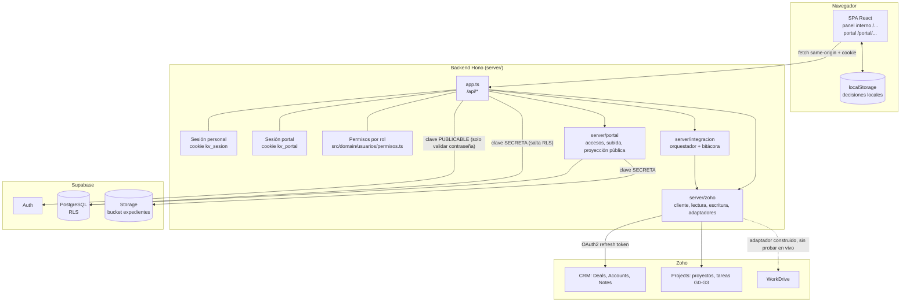
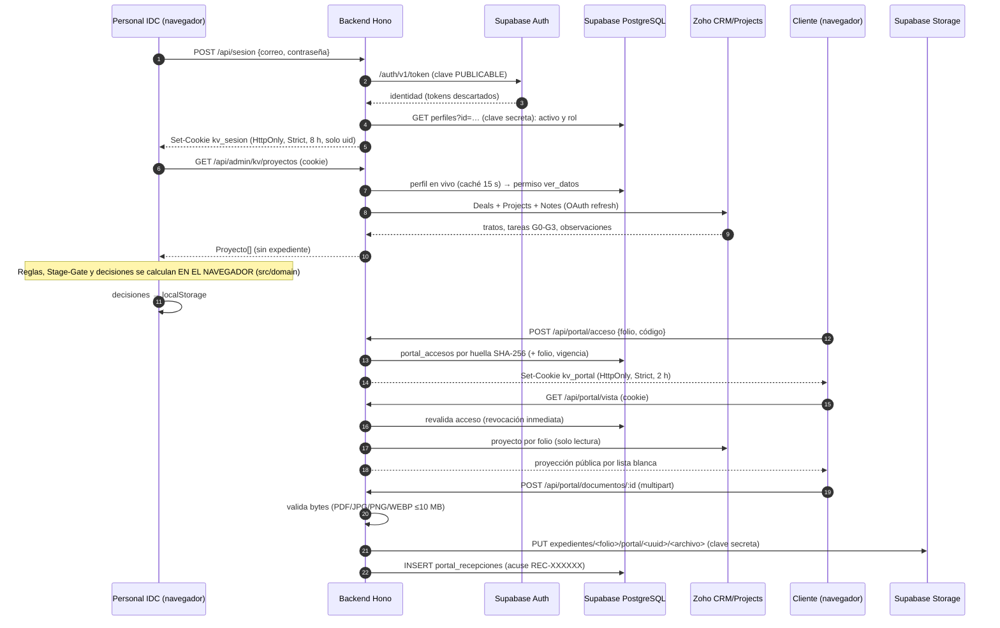

# Parte 01 — Arquitectura, flujos y cómo se ejecuta

## 1. Tecnologías y versiones **[V-CÓDIGO]** (`package.json`)

| Capa | Tecnología | Versión (rango en `package.json`) |
| --- | --- | --- |
| UI | React | ^19.3.1 |
| Enrutado | react-router-dom | ^7.18.6 (modo SPA con `BrowserRouter`; no es Remix/Next) |
| Build/dev | Vite | ^8.3.8 con `@vitejs/plugin-react` ^6.3.0 |
| Lenguaje | TypeScript (estricto, `noUncheckedIndexedAccess`) | ^7.0.2 |
| Backend | Hono | ^4.13.20 + `@hono/node-server` ^2.1.11 |
| Ejecutor backend | `tsx` ^4.23.15 (Node ≥ 22: usa `--env-file-if-exists`) |
| Pruebas | Vitest | ^5.1.1 (entorno `node`; **no hay jsdom ni Playwright**) |
| Estilos | **CSS plano con variables** (`src/styles/*.css`) — **no hay Tailwind ni shadcn/ui** |
| Fuentes | Inter + IBM Plex Mono vía Google Fonts (`index.html`), con respaldo del sistema |

- **No hay** SDK de Supabase (`@supabase/supabase-js`) ni SDK de Zoho: todo es `fetch` propio (`server/supabase/cliente.ts`, `server/zoho/cliente.ts`).
- **No hay** ESLint, Prettier ni CI configurados. El «linter» es `tsc --noEmit`.
- **No es Next.js**: es una SPA Vite + un backend Hono separado, montado **dentro del servidor de desarrollo de Vite** (`server/vite-plugin.ts`) para usar un solo puerto.

## 2. Estructura de carpetas y responsabilidad

```
C:\Kairovolt
├─ api/index.ts                 Entrada serverless para Vercel (misma app Hono). SIN PROBAR. Ver hallazgo A-5 (falta PATCH).
├─ server/                      BACKEND (Hono). Único lugar con secretos.
│  ├─ app.ts                    Todas las rutas /api/*, autenticación, permisos, montaje del portal.
│  ├─ config.ts                 Lee variables de entorno → ConfigServidor (valida hosts de Zoho/Supabase).
│  ├─ sesiones.ts               Cookie de sesión sin estado (HMAC) + limitador de intentos (en memoria).
│  ├─ index.ts / vite-plugin.ts Arranque (npm start) / montaje en `vite` (npm run dev).
│  ├─ supabase/                 Cliente REST/Auth de Supabase con la clave secreta; login, perfiles, usuarios, cuenta, auditoría.
│  ├─ zoho/                     OAuth, cliente con reintentos, lectura/escritura de CRM+Projects, adaptadores (Fase 3), mapeo editable.
│  ├─ integracion/              Fábrica de adaptadores (real/DEMO), bitácora y referencias (memoria o Supabase).
│  └─ portal/                   Portal del cliente: accesos, sesión propia, subida segura, rutas, adaptadores memoria/Supabase.
├─ src/                         FRONTEND + dominio compartido con el backend.
│  ├─ domain/                   Reglas puras de negocio (sin React ni red). Importadas también por el backend.
│  ├─ application/              Casos de uso y PUERTOS (interfaces): analizar proyecto, cartera, decisiones, portal, integración.
│  ├─ infrastructure/           Adaptadores del frontend: HTTP al backend, repositorio MOCK, decisiones en localStorage.
│  ├─ data/                     Datos de PRUEBA: caso KV-2026-004, proyecto de referencia, catálogo de requisitos del código.
│  ├─ hooks/                    Contextos y hooks (FuenteDatos, PortalContexto, useExpediente, useConfirmacion).
│  ├─ components/{ui,layout,feature,portal}/   Sistema de componentes (Fase 5) y piezas del portal (Fase 7).
│  ├─ pages/                    Pantallas del panel interno y `pages/portal/` (portal del cliente).
│  └─ styles/                   tokens.css (paleta), global.css, componentes.css, portal.css.
├─ supabase/                    SQL: 7 migraciones + seed + README. NO se ejecutan solas: se aplican a mano en el SQL Editor.
├─ docs/                        ZOHO_SETUP.md, REGLAS.md, PORTAL.md, PROMPT_SUPABASE_CHATGPT.md y esta auditoría.
└─ dist/                        Build (ignorado por git).
```

**Dependencia de capas (verificada por imports):** `domain` ← `application` ← `infrastructure`/`hooks` ← `components` ← `pages`. El backend (`server/`) importa `src/domain/*`, `src/application/portal-cliente.ts`, `src/application/integracion/*` y `src/data/*` **con rutas relativas** (el alias `@/` solo existe en Vite/tsx; ver hallazgo M-9).

## 3. Arquitectura implementada

Arquitectura en capas con **puertos y adaptadores** en el frontend (`ProyectoRepositorio`, `SincronizacionRepositorio`, `PortalRepositorio`, `DecisionesRepositorio`, `IntegracionAdminRepositorio`) y en el backend (`AccesosPortal`, `RecepcionesPortal`, `AlmacenPortal`, `FuenteProyectoPortal`, `PuertoCrm/GestionProyectos/Archivos`). El dominio no importa React, Zoho ni Supabase.

### 3.1 Diagrama de arquitectura



**Hecho clave para la seguridad:** el navegador **nunca** habla con Supabase ni con Zoho; solo con `/api/*` del mismo origen. Por tanto las políticas RLS **solo protegen accesos directos a PostgREST con un JWT** (que esta app no genera ni entrega al navegador). El control de acceso efectivo lo hace el backend, que usa la **clave secreta** (salta RLS) **[V-CÓDIGO]** `server/supabase/cliente.ts`.

### 3.2 Diagrama de comunicación (login, panel, portal)



## 4. ¿De dónde sale cada dato? (resumen; tabla completa en la parte 03)

| Origen | Qué contiene realmente hoy |
| --- | --- |
| **Zoho (real, lectura)** | Tratos (Deals) cuyo nombre empieza con el folio, cuenta/contacto, proyectos de Projects, tareas «G0…G3» con estado y fechas, notas de observaciones. |
| **Supabase (real)** | Perfiles/roles (login), auditoría de acciones del panel, bitácora de sincronización, referencias externas, accesos y recepciones del portal, `proyectos` mínimo (folio) para los accesos. |
| **Solo en el navegador** | Decisiones humanas (observaciones registradas, responsables, resoluciones, cambios de compuerta y aprobaciones en modo MOCK), en `localStorage` bajo `kairovolt:decisiones:<FOLIO>`. |
| **Datos de demostración en código** | `src/data/kv-2026-004.demo.ts` (caso KV-2026-004: expediente, configuración técnica, hitos, PAER), `src/data/proyecto-referencia.mock.ts` (KV-MOCK-0001, solo pruebas), `src/data/catalogo-requisitos.mock.ts` (catálogo de 21 requisitos **del código**). |

## 5. ¿Qué es real y qué es simulación?

- **Real y conectado:** login por correo/contraseña (Supabase Auth), perfiles y roles, permisos en el backend, lectura de Zoho, cambio de estado de compuertas en Zoho Projects, creación de observaciones/cierre en Zoho CRM (notas), auditoría de esas acciones, usuarios (alta/cambio de rol/activar), cambio de contraseña, recuperación por correo (depende de SMTP de Supabase: **[NO-VERIFICABLE]**).
- **Construido pero NO probado en vivo:** orquestador de sincronización (CRM upsert, Projects creación, WorkDrive), adaptadores de Supabase del portal (accesos, recepciones, Storage), bitácora en Supabase de la Fase 3, función Vercel.
- **Simulado / demo:** todo el expediente documental, PAER, hitos y datos técnicos (caso KV-2026-004), portal en modo DEMO (memoria, archivos descartados), adaptadores `DEMO — NO CONECTADO`.

## 6. Qué pasa desde que alguien inicia sesión hasta que usa la plataforma

**Personal** **[V-CÓDIGO]** `server/app.ts` (`/api/sesion`), `src/hooks/FuenteDatos.tsx`, `src/pages/Acceso.tsx`:

1. Al abrir la SPA, `FuenteDatosProvider` pregunta `GET /api/integracion/estado` (público) y `GET /api/sesion`.
2. `elegirFuente()` decide: **datos Zoho** solo si Zoho autenticó **y** hay sesión; si no, **MOCK** con el motivo visible (franja «Datos MOCK · …»).
3. Login (`/acceso`): correo+contraseña → backend valida con Supabase Auth (clave publicable), **descarta los tokens de Supabase**, consulta `perfiles` (debe estar `activo`) y entrega la cookie `kv_sesion` (HMAC, solo `uid`, 8 h). Alternativa: `ADMIN_TOKEN` de emergencia → rol `admin`.
4. En cada petición `/api/admin/*`: se lee la cookie, se busca el perfil (caché 15 s) y se exige el permiso de la ruta (`exigir('…')`). Escrituras con cookie exigen la cabecera `X-Requested-With: kairovolt` (anti-CSRF).
5. Pantallas internas **no están protegidas por ruta en el cliente**: sin sesión se ven con datos MOCK (demo). Con datos reales, es el backend quien deniega (401/403).
6. Cerrar sesión: `DELETE /api/sesion` borra la cookie (no hay lista de revocación: una cookie copiada vale hasta 8 h o hasta rotar `SESSION_SECRET`).

**Cliente** (portal): `/portal` → folio + código → cookie `kv_portal` → `/portal/inicio|documentos|avisos|historial` (detalle en la parte 02 §8 y `docs/PORTAL.md`).

## 7. Variables de entorno (solo nombres) **[V-CÓDIGO]** `server/.env.example`, `server/config.ts`

`ZOHO_ACCOUNTS_URL`, `ZOHO_PROJECTS_URL`, `ZOHO_CLIENT_ID`, `ZOHO_CLIENT_SECRET`, `ZOHO_REFRESH_TOKEN`, `ZOHO_PROJECTS_PORTAL_ID`, `ZOHO_WORKDRIVE_ROOT_FOLDER_ID`, `ADMIN_TOKEN`, `SESSION_SECRET`, `APP_URL`, `SUPABASE_URL`, `SUPABASE_PUBLISHABLE_KEY` (alias `SUPABASE_ANON_KEY`), `SUPABASE_SECRET_KEY` (alias `SUPABASE_SERVICE_ROLE_KEY`), `PORTAL_MODO_DEMO`, `PORT`.
Nota: `.env.example` también lista `DATABASE_URL` y `SUPABASE_JWKS_URL`, que **ningún código lee** (restos de la guía inicial) y **no incluye** `SESSION_SECRET` ni `APP_URL`, que sí se leen. `server/.env` está en `.gitignore` (`.env`, `.env.*`, `!.env.example`) **[V-CÓDIGO]**.

## 8. Comandos

| Para | Comando |
| --- | --- |
| Instalar | `npm install` |
| Desarrollo (interfaz + API, un puerto) | `npm run dev` |
| Producción local (compila y sirve dist + API en 127.0.0.1:8787) | `npm start` |
| Solo API | `npm run server` |
| Typecheck | `npm run typecheck` |
| Pruebas | `npm test` (= `vitest run`) |
| Build | `npm run build` (typecheck + vite build) |
| Galería de componentes (solo dev) | `/componentes` |

## 9. Inventario de archivos relevantes

### Backend

| Ruta | Qué es |
| --- | --- |
| `server/app.ts` | **Todas** las rutas, login, permisos, auditoría, montaje del portal y administración de accesos. |
| `server/config.ts` | Variables → configuración; valida que los hosts de Zoho/Supabase sean oficiales (evita fuga de secretos). |
| `server/sesiones.ts` | Cookie HMAC sin estado + limitador por clave (en memoria). |
| `server/supabase/{cliente,login,perfiles,usuarios,cuenta,auditoria}.ts` | Cliente REST/Auth, login, perfil en vivo con caché, CRUD de usuarios, cambio de contraseña, escritura de auditoría. |
| `server/supabase/falso.ts` | Supabase simulado para pruebas. |
| `server/zoho/{auth,cliente}.ts` | OAuth (refresh token), cliente con reintentos/errores clasificados. |
| `server/zoho/{lectura,adaptar,observaciones,escritura,mapeo}.ts` | Lectura de tratos/proyectos/notas, conversión a `Proyecto`, escritura de compuertas y observaciones, **mapeo editable**. |
| `server/zoho/{crm,projects,workdrive}-adapter.ts`, `mapper.ts` | Adaptadores de la Fase 3 (upsert, creación, WorkDrive). |
| `server/integracion/{fabrica,demo,memoria,supabase}.ts` | Elige real/DEMO; bitácora y referencias. |
| `server/portal/{rutas,acceso…}` → `rutas.ts, codigo.ts, sesion.ts, archivos.ts, memoria.ts, supabase.ts, fuente-zoho.ts, tipos.ts` | Portal: ver parte 02 §8. |
| `server/*.test.ts`, `server/**/**.test.ts` | Pruebas del backend (ver parte 04). |

### Dominio y aplicación (compartidos)

| Ruta | Qué es |
| --- | --- |
| `src/domain/reglas/*` | **Motor de reglas** (27 reglas, resultado único, severidades, overrides). |
| `src/domain/compuertas/{compuerta,bloqueo,transiciones,aprobacion}.ts` | Orden G0–G3, bloqueos con todas las razones, transiciones válidas, aprobaciones. |
| `src/domain/observaciones/{observacion,resolucion}.ts` | Observaciones, resoluciones humanas, excepciones por valor, reapertura. |
| `src/domain/checklist/checklist.ts`, `src/domain/vigencias`, `src/domain/validacion` | Checklist por compuerta, política de zona UVIE, vigencias, validación cruzada **legada** (aún usada por el portal). |
| `src/domain/{indicadores,cronograma,tiempos,acciones}` | PPC, PAER, actividades, tiempos entre hitos, acuerdos semanales. |
| `src/domain/portal/{avance,textos}.ts` | Reglas explícitas del % de avance y lenguaje para el cliente. |
| `src/domain/usuarios/{permisos,rol,credenciales}.ts` | **Matriz de permisos** (la misma que exige el backend), roles, contraseñas. |
| `src/domain/{clasificacion,folio}/…`, `entidades/version-documento.ts` | Clasificación de documentos por nombre, folios, versiones: **escritos y probados pero sin uso en ninguna pantalla**. |
| `src/application/{analizar-proyecto,cartera,decisiones,historial,vista-proyectos}.ts` | Casos de uso del panel. |
| `src/application/portal-cliente.ts`, `portal-acceso.ts` | Proyección pública (lista blanca) y puerto del portal. |
| `src/application/integracion/*` | Puertos y orquestador de sincronización (idempotente, simulación por defecto). |

### Frontend

| Ruta | Qué es |
| --- | --- |
| `src/App.tsx`, `src/main.tsx` | Rutas y arranque. |
| `src/hooks/{FuenteDatos,PortalContexto,useExpediente,useConfirmacion}.ts(x)` | Fuente de datos (Zoho/MOCK), sesión del portal, carga+análisis+decisiones, confirmaciones. |
| `src/infrastructure/*` | `zoho-http.ts` (repositorio real), `proyecto-repositorio.mock.ts`, `decisiones-local.ts`, `portal-http.ts`, `portal-admin-http.ts`, `integracion-*.ts`, `usuarios-http.ts`, `cuenta-http.ts`. |
| `src/components/ui/*`, `feature/*`, `layout/*`, `portal/*` | Componentes. |
| `src/pages/*` | Pantallas (parte 03 §7). |
| `src/data/*.mock.ts`, `kv-2026-004.demo.ts` | Datos de prueba. |

### SQL y documentación

| Ruta | Qué es |
| --- | --- |
| `supabase/migrations/20261122000001…0007_*.sql` | Esquema (parte 02). |
| `supabase/seed.sql` | Proyectos `KV-MOCK-0001` (demo) y `KV-2026-004`. |
| `supabase/README.md` | Guía y lista de desajustes **(parcialmente desactualizada: dice «el backend aún no usa Supabase»)**. |
| `docs/ZOHO_SETUP.md`, `docs/REGLAS.md`, `docs/PORTAL.md` | Guías. |
| `README.md` (raíz) | **Desactualizado**: dice «no hay conexión real con Zoho» y «npm test: reglas de dominio». |
